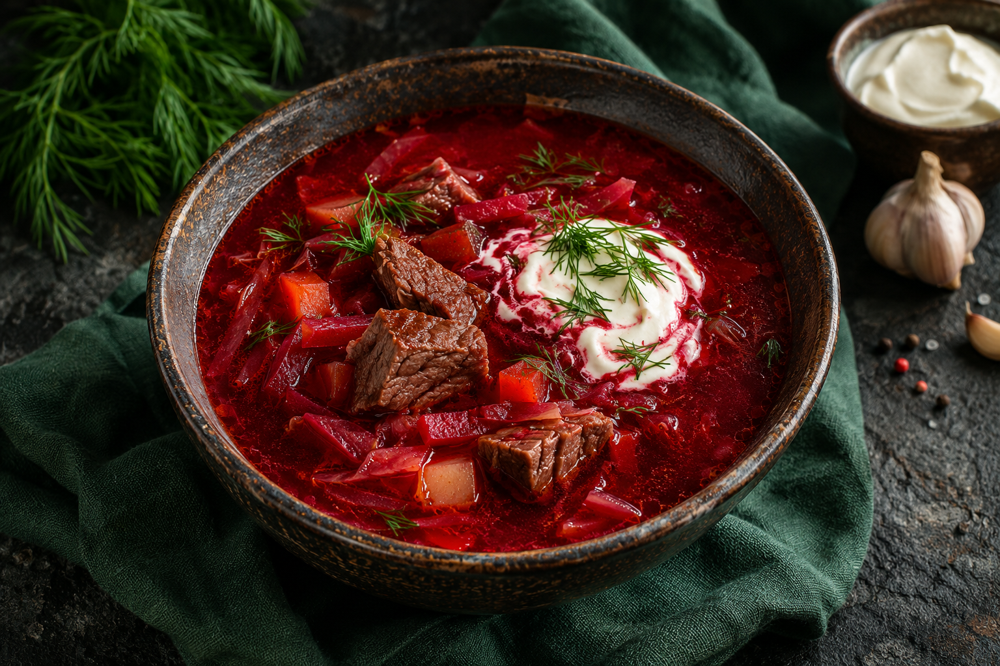

# Борщ

- **Автор:** Ник
- **Время:** 90 минут
- **Порций:** 4

## Ингредиенты

- Говядина — 400 г
- Вода — 2 л
- Свёкла — 1 шт.
- Картофель — 3 шт.
- Капуста — 250 г
- Морковь — 1 шт.
- Лук — 1 шт.
- Томатная паста — 2 ст. л.
- Растительное масло — 2 ст. л.
- Соль и перец — по вкусу

## Приготовление

1. Залейте говядину водой и варите до готовности. Достаньте мясо и нарежьте.
2. Добавьте в бульон нарезанный картофель, через 10 минут — нашинкованную капусту.
3. Обжарьте лук и морковь. Добавьте натёртую свёклу и томатную пасту, тушите 10 минут.
4. Переложите овощи и мясо в кастрюлю. Посолите, поперчите и варите ещё 10 минут.
5. Дайте борщу настояться под крышкой перед подачей.

## Совет автора

Подавайте со сметаной и зеленью.