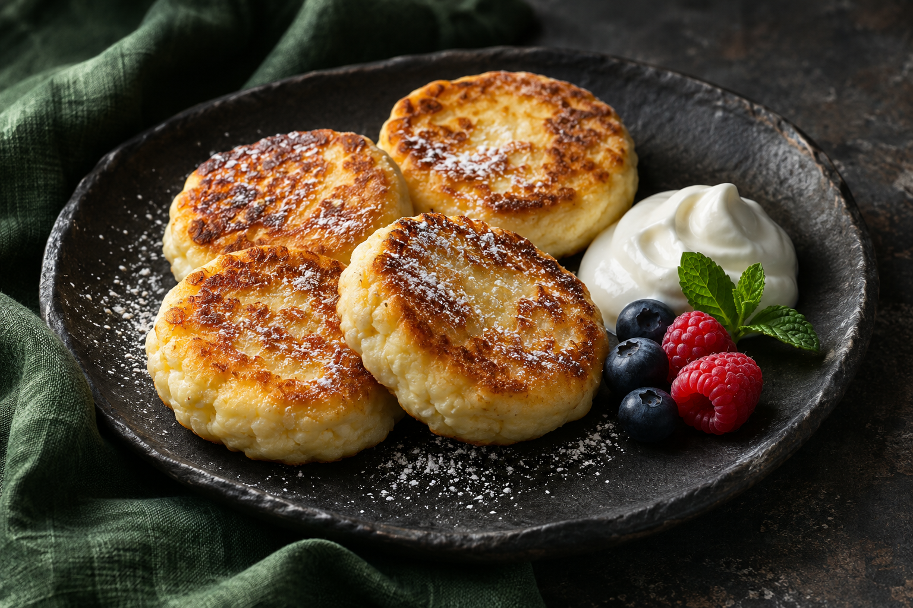

# Сырники

- **Автор:** Ник
- **Время:** 25 минут
- **Порций:** 2

## Ингредиенты

- Творог — 300 г
- Яйцо — 1 шт.
- Мука — 3 ст. л.
- Сахар — 1 ст. л.
- Растительное масло — 1 ст. л.

## Приготовление

1. Смешайте творог, яйцо, сахар и муку.
2. Сформируйте небольшие сырники и слегка обваляйте их в муке.
3. Разогрейте масло на сковороде.
4. Обжаривайте сырники на среднем огне по 3–4 минуты с каждой стороны.

## Совет автора

Подавайте со сметаной или ягодами.